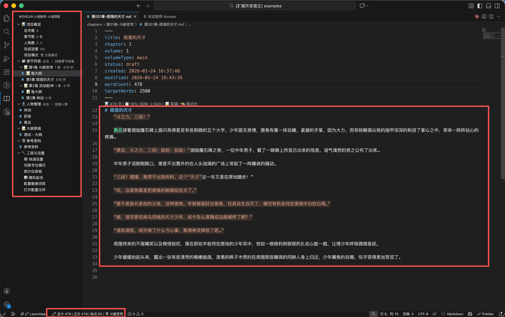
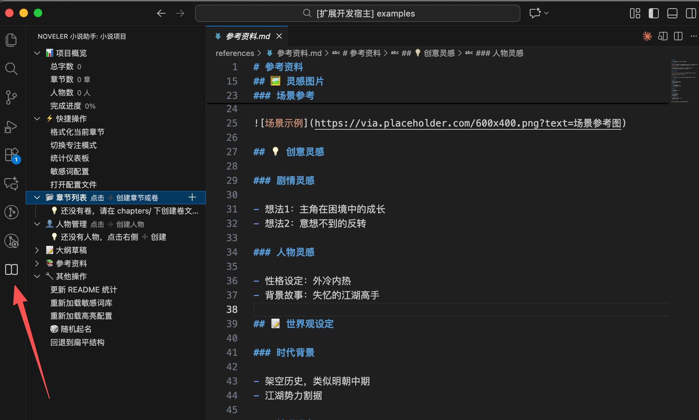

# Noveler - 中文小说写作助手

专为中文小说写作设计的 VS Code 插件，让创作更专注、更高效。

## 📑 目录

- [✨ 核心特性](#核心特性)
- [🎛️ 侧边栏视图](#侧边栏视图)
- [🚀 核心功能](#核心功能)
  - [📝 语法高亮](#语法高亮)
  - [📊 字数统计](#字数统计)
  - [🎨 智能格式化](#智能格式化)
  - [🛡️ 敏感词检测](#敏感词检测)
  - [📚 分卷管理](#分卷管理)
  - [✍️ 随机起名](#随机起名)
- [📌 写作待办](#写作待办)
  - [📂 项目管理](#项目管理)
  - [🖋️ 写作辅助](#写作辅助)
- [⚡ 快速开始](#快速开始)
- [📄 文件格式](#文件格式)
- [⚙️ 配置](#配置)
- [🎮 常用命令](#常用命令)
- [❓ 常见问题](#常见问题)
- [🎉 版本亮点](#版本亮点)
- [🤝 贡献](#贡献)
- [📜 开源协议](#开源协议)
- [📞 联系方式](#联系方式)

---

<a id="核心特性"></a>

## ✨ 核心特性

- 📝 **语法高亮** - 对话、人物名称自动高亮，内容一目了然
- 📊 **精准字数** - 符合网文标准的实时字数统计
- 🛡️ **敏感词检测** - 三级词库自动检测，规避审核风险
- 📚 **分卷管理** - 支持多卷结构，适合长篇创作
- ✍️ **随机起名** - 7 种风格，数千种组合，一键生成角色名
- 🎨 **智能格式化** - 标点、引号、空格自动规范
- 👁 **护眼模式** - 低饱和度暖灰绿主题，保护视力
- 📱 **手机预览** - 仿真 iPhone 阅读效果，实时同步编辑内容
- 📌 **写作待办** - 随手标记疑问和待处理内容，侧边栏统一收束管理



---

<a id="侧边栏视图"></a>

## 🎛️ 侧边栏视图

点击左侧活动栏的 📖 图标打开 Noveler 侧边栏，这是插件的主要操作界面。



### 项目概览
- 显示小说名称、总字数、章节数
- 一键访问配置文件
- 快速更新 README

### 章节管理
- 查看所有章节及状态（📝草稿 | ✏️初稿 | 🔧修改中 | ✅已完成）
- 右键章节：重命名、标记状态、删除
- 鼠标悬停显示详细字数统计
- **分卷支持**：创建卷、在卷内创建章节、移动章节

### 人物设定
- 查看所有人物档案
- 创建人物文件
- **随机起名**：一键生成各种风格的角色名

### 快捷操作
- 刷新视图（README 更新受配置开关控制）
- 章节和人物标题上方可点击“格式化”；Markdown 编辑器右上角及右键菜单也提供入口
- 专注设置位于“项目设置 → 快速设置”

### 工具与设置
- 写作工具：使用指南、统计仪表板、手机预览、随机起名
- 项目设置：快速设置、敏感词库配置、重新加载敏感词库、打开配置文件
- 护眼、专注和章节编号等选项可在快速设置中调整
- 结构迁移：点击「项目概览」中的「项目模式」，或使用命令面板中的迁移和回滚命令

---

<a id="核心功能"></a>

## 🚀 核心功能

<a id="语法高亮"></a>

### 📝 语法高亮

自动高亮对话和人物名称，让小说内容层次分明。

- 支持常见成对引号：`「」`、直双引号、直单引号、弯双引号和弯单引号
- 自动读取 `characters/` 目录和配置文件中的人物名称
- 可自定义高亮颜色和样式


---

<a id="字数统计"></a>

### 📊 字数统计

符合网文标准的实时统计，状态栏显示 `总计 | 正文 | 标点`。

**特点**：
- ✅ 实时更新，选中文本单独统计
- ✅ 全文统计排除 Front Matter、整行标题和 HTML 注释；选中统计保留标题
- ✅ 侧边栏悬停查看详细统计
- ✅ 保存时更新已有的 `wordCount` 字段
- ✅ 分卷模式下显示所属卷信息

**统计规则**：
- 总计 = 正文 + 标点（不含空格）
- 正文 = 中文汉字 + 英文字母和数字
- 标点 = 中文标点 + 英文标点

---

<a id="智能格式化"></a>

### 🎨 智能格式化

一键规范标点、引号、空格，让文稿更专业。

- **引号统一**：自动转换中英文引号为配置的样式
- **标点规范**：统一中文标点符号（双向转换）
- **空格处理**：删除中文之间多余的空格
- **特殊符号**：统一省略号（…）和破折号（——）

入口：章节和人物档案标题上方的“格式化”，或 Markdown 编辑器右上角的格式化图标、编辑器右键菜单。草稿、参考资料以及没有标题的文档也可以使用后两种入口。

> 💡 Front Matter 和 HTML 注释内容不会被格式化

---

<a id="敏感词检测"></a>

### 🛡️ 敏感词检测

三级词库系统，自动检测敏感词汇，帮助规避审核风险。

**三级词库**：
- **高危**：政治、严重暴力、严重违法（推荐启用）
- **中危**：色情、一般违法、宗教敏感（推荐启用）
- **低危**：广告、争议词汇、不文明用语（可选启用）

**检测方式**：
- ⚡ 输入时自动检测（防抖 500ms）
- 💾 保存时再次检查
- 📊 状态栏显示敏感词数量

**可视化标注**：
- 黄色波浪线标记敏感词
- 问题面板显示详细信息
- 悬停查看词汇等级和建议


**快速修复**：
- 添加到白名单（如人物名、专有名词）
- 删除敏感词
- 替换为星号（***）
- 忽略本文件中的该词（当前会话）

**自定义词库**：支持项目级黑名单和白名单配置

---

<a id="分卷管理"></a>

### 📚 分卷管理

支持多卷结构，适合长篇小说创作。

**功能**：
- 📖 创建卷：在侧边栏点击创建，支持正文/前传/后传/番外
- 📝 章节管理：在卷内创建章节，移动/复制章节到其他卷
- 🔄 结构迁移：一键从扁平结构迁移到分卷，支持回滚
- 📊 统计显示：状态栏显示当前章节所属卷及统计信息

**卷类型**：
- **正文**：主线剧情
- **前传**：故事发生前的剧情
- **后传**：主线之后的延续
- **番外**：独立的特别篇章

**章节编号模式**：
- 全局连续：所有章节连续编号（第 1 章、第 2 章...）
- 按卷重置：每卷独立编号
- 混合模式：正文卷全局编号，前传、后传和番外独立编号

这些设置控制新章节编号，切换模式不会自动重排已有章节。

**迁移保护**：
- 迁移前检查同名章节冲突，自动保存相关文档并创建临时备份；校验成功后清理备份。
- 操作失败会尝试恢复，恢复不完整时保留备份并提示路径。
- 回到扁平结构仅将章节移到 `chapters/` 根目录，卷大纲、元数据和附属文件保留在原卷目录。
- 再次分卷可复用原卷目录，按本次选择重新分配章节；已有卷资料不覆盖。

---

<a id="随机起名"></a>

### ✍️ 随机起名

一键生成角色名，7 种风格任选。

**风格选择**：
- 🇨🇳 中文现代：常见姓氏 + 现代名字
- 🏮 中文古典：单字名、双字名、雅致字
- ⚔️ 中文玄幻：仙侠、玄幻命名规则
- 🇬🇧 英文名：First Name + Last Name
- 🇯🇵 日文名：日式姓氏 + 名字
- 🏰 西幻名：奇幻风格命名
- 🌀 虚构名：完全虚构的独特名字

**智能交互**：
- "再来一组"快速生成更多选项
- 创建人物文件
- 复制到剪贴板
- 插入到光标位置

**名字库**：数百个精选名字，组合可能性达数千至数万

---

### 📱 手机阅读预览

模拟手机屏幕预览小说阅读效果，实时同步编辑内容。

**仿真外观**：
- iPhone 15/16 Pro 尺寸（393×852）
- 灵动岛、侧边按钮、状态栏等细节还原
- 4 种阅读主题：日间、夜间、羊皮纸、护眼绿

**阅读设置**：
- 字号调整（14-24px）
- 行距调整（1.5-2.5）
- 字体切换（系统、宋体、黑体）
- 设置自动保存

**智能同步**：
- 编辑内容实时更新预览
- 光标位置自动高亮对应段落
- 智能滚动跟随（底部编辑时自动跟随，中间阅读时保持位置）
- 对话内容自动高亮

**入口**：
- 侧边栏「工具与设置」→「写作工具」→「手机预览」
- 命令面板：`Noveler: 手机阅读预览`

---

<a id="写作待办"></a>

### 📌 写作待办

写作过程中随手标记疑问和待处理内容，侧边栏统一收束，提醒自己稍后回头解决。

**使用方法**：

1. 在任意 Markdown 文件中，将光标移到需要标记的位置
2. 按 `Ctrl+Shift+/`，输入待办内容，回车确认
3. 该行末尾自动插入 `<!--? 内容 -->` 标记，行内装饰高亮提示

**侧边栏**：

- 「写作待办」节点展示所有标记，按文件分组，显示待处理 / 总计数量
- 点击条目直接跳转到对应文件和行
- 条目右键：标记为已完成 / 重新打开 / 删除
- 根节点右键：筛选显示（全部 / 仅待处理）、批量完成、批量删除已完成

**编辑器内**：

- 待处理行显示橙色左边框
- 已完成行半透明置灰
- 标记行上方显示 CodeLens 快捷操作：`$(bookmark) 写作待办  $(check) 标记已完成  $(trash) 删除`

**标记语法**：

| 状态 | 语法 |
|---|---|
| 待处理 | `<!--? 内容 -->` |
| 已完成 | `<!--✓ 内容 -->` |

> 标记不计入正文统计，普通 Markdown 预览会隐藏 HTML 注释；手机预览目前仍可能显示注释文本。

完成待办会将 `<!--? ... -->` 改为 `<!--✓ ... -->`，删除请使用待办的“删除”命令。
`doubtMark.deleteOnResolve` 当前未正确接入，暂不作为可用开关。

---

<a id="项目管理"></a>

### 📂 项目管理

快速创建和组织你的小说项目。

**初始化项目**：一键创建标准的小说项目结构
```
my-novel/
├── chapters/       # 章节目录
├── characters/     # 人物目录
├── drafts/         # 草稿和大纲
├── references/     # 参考资料
├── novel.jsonc     # 小说配置
└── README.md       # 项目说明
```

**创建章节**：
- 自动计算章节序号（支持中文数字：第一章、第十章、第一百章等）
- 带有完整 Front Matter 的标准章节模板
- 自动组织到 `chapters/` 目录

**创建人物**：
- 一键创建人物档案文件
- 完整的人物信息模板（外貌、性格、背景、关系等）
- 自动保存到 `characters/` 目录

**README 自动更新**：
- 扫描章节目录，统计总字数和完成章节数
- 自动生成章节列表（带状态图标）
- 自动扫描并分类展示人物

---

<a id="写作辅助"></a>

### 🖋️ 写作辅助

更多实用功能，提升写作体验。

- **自动空行**：按回车时自动插入空行，保持段落间距
- **段落缩进**：自动添加两个全角空格缩进
- **专注模式**：打开专注模式设置后，选择“一键专注”或“Zen Mode”
- **护眼模式**：一键切换护眼主题，低饱和度暖灰绿背景，保护视力（仅当前项目生效）
- **项目级配置**：初始化时自动创建 `.vscode/settings.json`（自动保存、格式化等）
- **输入验证**：创建章节和人物时自动过滤非法字符

---

<a id="快速开始"></a>

## ⚡ 快速开始

### 1. 安装插件

在 VS Code 扩展市场搜索 "Noveler" 并安装。

或按 `Cmd+Shift+X` (Mac) / `Ctrl+Shift+X` (Windows/Linux) 打开扩展面板。

### 2. 打开侧边栏

点击左侧活动栏的 📖 图标，打开 Noveler 侧边栏。

### 3. 初始化项目

在侧边栏点击"初始化项目"按钮，输入小说名称。

插件会自动创建标准的小说项目结构，包括：
- 📁 项目目录（chapters, characters, drafts, references）
- 📝 配置文件（novel.jsonc）
- ⚙️ **VSCode 项目配置**（`.vscode/settings.json`）
  - ✅ 自动保存（默认 2 秒延迟；已有设置保留原值）
  - ✅ 文件格式化（自动清理行尾空格）
  - ✅ Markdown 预览优化
  - ✅ 仅对当前项目生效，不影响其他项目

### 4. 创建章节

在侧边栏"章节管理"组点击 ➕ 按钮，输入章节名称（如"陨落的天才"）。

章节号会自动计算和添加。

### 5. 开始写作

打开章节文件，享受语法高亮和实时字数统计！

> 💡 提示：也可以使用命令面板（`Cmd/Ctrl+Shift+P`）输入"Noveler"查看所有命令。

---

<a id="文件格式"></a>

## 📄 文件格式

### 章节文件示例

```markdown
---
title: "初入江湖"
chapter: 1
wordCount: 0
status: "draft"  # draft | first-draft | revising | completed；兼容中文状态
---

# 第一章 初入江湖

清晨的阳光透过窗棂洒在青石板上。

「师父，我想下山。」张无忌低声说道。
```

**关键字段**：
- `title`: 章节标题
- `chapter`: 章节号
- `wordCount`: 字数（字段存在时，保存自动更新）
- `status`: 状态（影响侧边栏图标）

> 📖 完整字段说明请查看 [文件格式文档](docs/文件格式说明.md)

---

### 人物文件示例

```markdown
---
name: "张无忌"
gender: "男"
importance: "主角"
---

# 张无忌

## 基本信息
...

## 外貌描写
...
```

**关键字段**：
- `name`: 人物名称
- `importance`: 主角 | 重要配角 | 次要配角 | 路人
- `firstAppearance`: 首次登场章节

---

<a id="配置"></a>

## ⚙️ 配置

### 核心配置

在项目根目录的 `novel.jsonc` 文件中配置（侧边栏可一键打开）：

```jsonc
{
  "name": "我的小说",
  "noveler": {
    "targetWords": {
      "default": 2500
    },
    "sensitiveWords": {
      "enabled": true,
      "builtInLibrary": {
        "enabled": true,
        "levels": {
          "high": true,
          "medium": true,
          "low": false
        }
      }
    },
    "autoEmptyLine": {
      "value": true
    },
    "paragraphIndent": {
      "value": true
    },
    "autoUpdateReadmeOnCreate": {
      "value": "always"
    },
    "volumes": {
      "enabled": true,
      "folderStructure": "flat",
      "chapterNumbering": "volume",
      "numberFormat": "arabic"
    },
    "characters": {
      "list": []
    },
    "highlight": {
      "dialogue": {
        "color": "#ce9178"
      },
      "character": {
        "color": "#4ec9b0",
        "fontWeight": "bold"
      }
    },
    "format": {
      "chineseQuoteStyle": "「」",
      "convertQuotes": true
    }
  }
}
```

> 📖 完整配置说明请查看 [novel.jsonc 配置文档](docs/novel-json配置说明.md)

### 自动保存和保存时格式化

这两项由项目的 `.vscode/settings.json` 控制：

```jsonc
{
  "files.autoSave": "afterDelay",
  "files.autoSaveDelay": 2000,
  "[markdown]": {
    "editor.defaultFormatter": "chang.chinese-novel-writer",
    "editor.formatOnSave": true
  }
}
```

初始化只补充缺失设置，保留已有值。如果原项目配置了 `files.autoSave: "off"`，初始化后仍为关闭。
`noveler.autoSave` 不生效；`noveler.format.autoFormat` 当前未接入保存事件。

### README 更新范围

插件按 `## 目录`、`## 写作进度`、`## 人物设定`、`## 备注` 的顺序更新对应区域，区域内的手写内容会被替换。
没有 `## 备注` 时，人物区段更新至下一二级标题或文件末尾。
自定义说明请放在这些区域之外，建议放在 `## 备注` 下。
`noveler.autoUpdateReadmeOnCreate.value` 为 `never` 时，“刷新”也会跳过 README 更新；改回 `always` 后再刷新。

---

<a id="常用命令"></a>

## 🎮 常用命令

| 命令 | 说明 | 快捷方式 |
|------|------|----------|
| `Noveler: 初始化小说项目` | 在空文件夹中初始化项目结构 | 侧边栏按钮 |
| `创建章节` | 创建新章节文件 | 侧边栏 ➕ |
| `创建人物` | 创建人物文件 | 侧边栏 ➕ |
| `Noveler: 随机起名` | 随机生成角色名 | 侧边栏按钮 |
| `Noveler: 格式化文档` | 格式化当前文档 | 标题按钮、编辑器右上角、右键菜单 |
| `Noveler: 刷新` | 刷新侧边栏和统计信息 | 侧边栏按钮 |
| `Noveler: 切换专注模式` | 打开专注设置菜单 | 命令面板 |
| `Noveler: 添加写作待办` | 在当前行插入待办标记 | `Ctrl+Shift+/` |

> 💡 提示：按 `Cmd/Ctrl+Shift+P` 打开命令面板，输入 "Noveler" 查看所有命令

---

<a id="常见问题"></a>

## ❓ 常见问题

**Q: 如何打开侧边栏？**
A: 点击左侧活动栏的 📖 图标，或使用命令 `查看: 打开侧边栏`。

**Q: 字数统计包含标点吗？**
A: 包含。总计 = 正文（汉字+字母+数字）+ 标点。符合网文计费标准。

**Q: 敏感词检测会影响性能吗？**
A: 防抖和 Trie 树减少重复检测，但大文件和词库规模仍会影响性能。

**Q: 如何切换到分卷结构？**
A: 使用命令 `Noveler: 迁移到分卷结构`，插件会引导你完成迁移。支持随时回滚。

**Q: 格式化会修改我的内容吗？**
A: 不会修改文字，只调整标点符号和空格。Front Matter 和注释不受影响。

**Q: 为什么我的人物名称没有高亮？**
A: 确保人物文件在 `characters/` 目录下，或在 `novel.jsonc` 的 `noveler.characters.list` 数组中添加名称。

**Q: 自动空行和段落缩进冲突吗？**
A: 不冲突。可以同时启用：自动空行负责段落间隔，段落缩进负责每段开头。

> 更多问题请访问 [FAQ 文档](docs/FAQ.md) 或 [提交 Issue](https://github.com/ChangFang911/vscode-plugin-noveler/issues)

---

<a id="版本亮点"></a>

## 🎉 版本亮点

### 当前版本 v0.8.8
- 📌 **写作待办**：`Ctrl+Shift+/` 随手标记，侧边栏统一收束管理，支持 CodeLens 快捷操作

### v0.8.6
- 优化快速设置 UI，配置项按分组展示，交互更一致
- 侧边栏「工具与设置」拆分为「写作工具」和「项目设置」两级分组
- 侧边栏节点图标全面换用 ThemeIcon，随主题明暗自动切换
- 修复 CodeLens 进度图标损坏（显示为两个问号）

### 工作区修复（尚未发布）
- 文件操作保护未保存内容、YAML 注释和已有目标文件。
- 格式化保留待办注释，待办位置随编辑同步。
- 设置安全合并，迁移增加冲突检查、备份与失败恢复。

### v0.8.5
- 修复分卷模式下章节创建的多个问题（不打开编辑器、targetWords 不读配置、编号重复）
- 修复自动空行持续触发导致文件不断增加换行的问题
- 修复手机预览中单换行不显示段落分隔的问题
- 提取章节创建公共逻辑，消除重复实现

### v0.8.4
- 🎵 打字音效（7 种内置音效 + 自定义音效文件，默认关闭）

### v0.8.0 ~ v0.8.3
- 📱 手机阅读预览（仿真 iPhone 外观，4 种主题，实时同步光标段落）
- 👁 护眼模式（低饱和度暖灰绿主题，项目隔离不影响其他工作区）
- 🚀 性能优化（Trie 树人物高亮、配置加载竞态修复、字数统计缓存）

### v0.7.0
- 🎉 新手欢迎页面
- ⚙️ 快速设置面板（一键切换常用功能开关）

### 后续计划
- 📥 批量导入已有章节文件（txt 批量导入并自动生成 Front Matter）
- 🤖 AI 写作助手集成
- 📈 写作目标跟踪
- 🔄 更丰富的导出格式（EPUB、PDF）

> 完整更新历史请查看 [CHANGELOG.md](CHANGELOG.md)

---

<a id="贡献"></a>

## 🤝 贡献

欢迎提交 Issue 和 Pull Request！

开发和验证命令：

```bash
npm ci
npm run compile
npm run lint
npm run test:unit
npm test
```

`test:unit` 在 Node 中运行单元测试，`npm test` 启动真实 VS Code 扩展宿主，需桌面环境。
可以设置 `NOVELER_TEST_VSCODE_EXECUTABLE` 指向本机 VS Code 可执行文件；未设置时测试工具会下载 VS Code。
手动调试按 F5，启动目录见 `.vscode/launch.json`。


1. Fork 本仓库
2. 创建你的特性分支 (`git checkout -b feature/AmazingFeature`)
3. 提交你的更改 (`git commit -m 'Add some AmazingFeature'`)
4. 推送到分支 (`git push origin feature/AmazingFeature`)
5. 打开一个 Pull Request

---

<a id="开源协议"></a>

## 📜 开源协议

[MIT License](LICENSE)

---

<a id="联系方式"></a>

## 📞 联系方式

- **GitHub**: [https://github.com/ChangFang911/vscode-plugin-noveler](https://github.com/ChangFang911/vscode-plugin-noveler)
- **Issues**: [提交问题](https://github.com/ChangFang911/vscode-plugin-noveler/issues)
- **讨论**: [GitHub Discussions](https://github.com/ChangFang911/vscode-plugin-noveler/discussions)

---

**Happy Writing! 祝写作愉快！** ✍️
